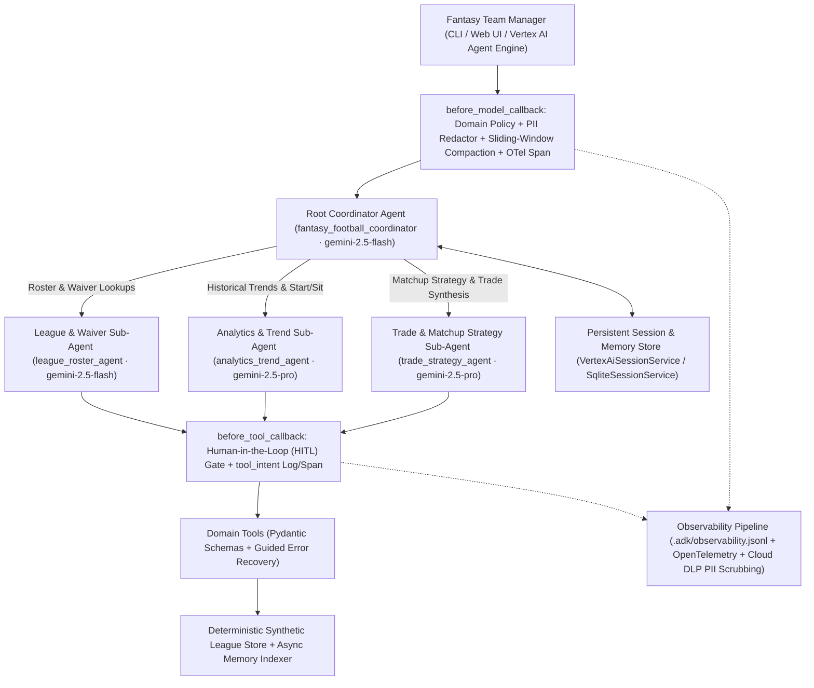

# Fantasy Football Personal Agent (`google-adk` + Gemini on Google Cloud)

An enterprise-grade, multi-agent **Fantasy Football Personal Assistant** built with the [Google Agent Development Kit (ADK) for Python](https://github.com/google/adk-python) and powered by **Gemini 2.5 Flash** and **Gemini 2.5 Pro** on **Google Cloud Vertex AI**.

Designed as a reference implementation for the **AgentOps Code Review Matrix** ([`docs/agent_rubric.md`](docs/agent_rubric.md)), this repository demonstrates production AgentOps patterns—strict Pydantic tool schemas, guided error recovery, context compaction, persistent session/memory services, strategic multi-agent model routing, Human-in-the-Loop (HITL) confirmation hooks, structured JSON observability (`structlog`), OpenTelemetry distributed tracing, active PII redaction, `adk eval` golden dataset evaluation, and Terraform Infrastructure as Code (IaC)—powered by a 100% deterministic **Synthetic Fantasy Football Data Engine**.

---

## Architecture Overview



### Core Capabilities
1. **Waiver Wire & Roster Management (`league_roster_agent` · `gemini-2.5-flash`)**:
   - Inspect starting lineups, bench depth, injuries, and usage metrics across the 4-team synthetic league (`team_alpha`, `team_bravo`, `team_charlie`, `team_delta`).
   - Search unrostered free agents by position and projected points (`search_available_waiver_players`).
2. **Historical Trends, Bench Efficiency & Scouting Insights (`analytics_trend_agent` · `gemini-2.5-pro`)**:
   - Compare 2023 vs. 2024 multi-season weekly scoring trajectories (`analyze_player_historical_trends`).
   - Identify optimal start/sit swaps and waiver drop candidates (`analyze_bench_and_start_sit`).
   - Retrieve synthesized injury, snap-share, and depth-chart insights (`search_player_and_team_insights`).
3. **Weekly Matchup Comparisons & Trade Discovery (`trade_strategy_agent` · `gemini-2.5-pro`)**:
   - Run head-to-head Week 8 / Week 9 positional projections and win-probability comparisons (`compare_weekly_matchup`).
   - Scan all league rosters to synthesize mutually beneficial win-win trades (`discover_mutually_beneficial_trades`, `evaluate_league_trade_proposal`).
   - Execute lineup swaps, waiver claims, and trade proposals behind an explicit **Human-in-the-Loop (HITL)** confirmation gate (`commit_lineup_waiver_or_trade_action`).

---

## Repository Structure

```text
adk_agent/
├── GEMINI.md                                  # AI assistant rules & architectural standards
├── pyproject.toml                             # uv project configuration & dependencies
├── uv.lock                                    # Deterministic dependency lockfile
├── README.md                                  # Setup, CLI, Terraform & AgentOps Rubric guide
├── docs/
│   ├── project_overview.md                    # High-level project requirements
│   └── agent_rubric.md                        # 19-criterion AgentOps Code Review Matrix
├── fantasy_agent/                             # Main Google ADK agent package
│   ├── __init__.py
│   ├── agent.py                               # Root coordinator agent (root_agent) & ADK App (app)
│   ├── config.py                              # Model routing, gcloud project resolver & Secret Manager
│   ├── prompts.py                             # System constitutions per agent
│   ├── data/
│   │   └── synthetic_league_store.py          # Deterministic synthetic league & AsyncFantasyMemoryIndexer
│   ├── sub_agents/
│   │   ├── league_roster_agent.py             # Fast lookup sub-agent (gemini-2.5-flash)
│   │   ├── analytics_trend_agent.py           # Longitudinal analytics sub-agent (gemini-2.5-pro)
│   │   └── trade_strategy_agent.py            # Matchup & trade synthesis sub-agent (gemini-2.5-pro)
│   ├── tools/
│   │   ├── schemas.py                         # Strict Pydantic input/output & ToolErrorOutput schemas
│   │   ├── roster_and_waiver_tools.py         # Roster lookup, matchup comparison & waiver tools
│   │   ├── analytics_tools.py                 # Historical trend, start/sit & scouting insight tools
│   │   └── trade_tools.py                     # Trade discovery, evaluation & HITL commit tools
│   ├── memory/
│   │   ├── compaction.py                      # Sliding-window compaction & ADK EventsCompactionConfig
│   │   └── session_store.py                   # VertexAiSessionService / SqliteSessionService & async memory
│   ├── callbacks/
│   │   ├── guardrails.py                      # Input/output guardrails, PII scrubbing & self-evaluation
│   │   └── hitl.py                            # before_tool_callback HITL confirmation gate
│   └── observability/
│       ├── logging.py                         # structlog JSON logger (.adk/observability.jsonl)
│       ├── tracing.py                         # OpenTelemetry spans & intent vs. outcome lifecycle hooks
│       └── pii_redactor.py                    # Regex + optional Cloud DLP PII scrubbing processor
├── tests/
│   ├── unit/                                  # 24 unit tests covering all 5 AgentOps rubric pillars
│   └── eval/                                  # ADK golden evaluation dataset & Trajectory/Response suite
└── terraform/                                 # Terraform IaC for Vertex AI Agent Engine, IAM & Secrets
```

---

## Quickstart & Local Development (`uv` + Google Cloud Vertex AI)

### Prerequisites
- **Python 3.11+** and **[`uv`](https://docs.astral.sh/uv/)**
- **Google Cloud SDK (`gcloud`)** authenticated against a GCP project with the Vertex AI API enabled

### 1. Install Dependencies
```bash
uv sync
```

### 2. Authenticate with Google Cloud Vertex AI
The agent automatically resolves your active GCP project from `GOOGLE_CLOUD_PROJECT` or `gcloud config get-value project` and defaults to Vertex AI in `us-central1`:
```bash
gcloud auth application-default login
export GOOGLE_CLOUD_PROJECT="$(gcloud config get-value project)"
export GOOGLE_CLOUD_LOCATION="us-central1"
export GOOGLE_GENAI_USE_VERTEXAI="TRUE"
```

### 3. Run the Agent Interactively (CLI or Web UI)

**Interactive CLI (`adk run`)**:
```bash
uv run adk run fantasy_agent
```

**Interactive Browser UI (`adk web`)**:
```bash
uv run adk web .
```

**Sample Prompts to Try**:
- *"Please analyze my bench for team_alpha and see who I should start or drop."*
- *"How does my team_alpha roster stack up against my Week 8 opponent?"*
- *"Scan the league and suggest a mutually beneficial trade for team_alpha to upgrade my Tight End."*
- *"How is my quarterback Josh Allen trending this season compared to last year?"*
- *"What are the latest injury and usage insights for Puka Nacua?"*
- *"Please swap Ladd McConkey into my starting lineup for Jaylen Warren."* (Triggers the **Human-in-the-Loop** confirmation prompt before mutating state!)

---

## Testing, Linting & Automated Evaluation (`pytest` & `adk eval`)

### 1. Run Unit & Offline Evaluation Tests
```bash
uv run ruff check .
uv run pytest -v
```

### 2. Run Live Multi-Agent Evaluation with `adk eval`
Evaluate the agent against [`tests/eval/golden_dataset.evalset.json`](tests/eval/golden_dataset.evalset.json) using ADK's CLI evaluator and [`tests/eval/test_config.json`](tests/eval/test_config.json):
```bash
uv run adk eval fantasy_agent tests/eval/golden_dataset.evalset.json \
  --config_file_path tests/eval/test_config.json \
  --print_detailed_results
```

You can also run a specific subset of golden evaluation cases:
```bash
uv run adk eval fantasy_agent \
  tests/eval/golden_dataset.evalset.json:eval_case_04_historical_qb_trend,eval_case_06_out_of_domain_guardrail_refusal \
  --config_file_path tests/eval/test_config.json \
  --print_detailed_results
```

---

## Infrastructure as Code (Terraform) & Cloud Deployment

All Google Cloud resources—APIs, least-privilege IAM Service Account, Secret Manager secret, Vertex AI Agent Engine GCS staging bucket, and Artifact Registry repository—are defined in [`terraform/`](terraform/).

### 1. Provision GCP Infrastructure with Terraform
```bash
terraform -chdir=terraform init
terraform -chdir=terraform plan -var="project_id=${GOOGLE_CLOUD_PROJECT}"
terraform -chdir=terraform apply -var="project_id=${GOOGLE_CLOUD_PROJECT}"
```

### 2. Deploy to Vertex AI Agent Engine (`adk deploy agent_engine`)
Using the staging bucket output by Terraform, deploy the multi-agent application directly to **Vertex AI Agent Engine** (managed runtime with `VertexAiSessionService` and `VertexAiMemoryBankService`):
```bash
uv run adk deploy agent_engine \
  --project="${GOOGLE_CLOUD_PROJECT}" \
  --region="us-central1" \
  --staging_bucket="gs://${GOOGLE_CLOUD_PROJECT}-fantasy-agent-staging" \
  --display_name="Fantasy Football Personal Agent" \
  fantasy_agent
```

### 3. Optional: Deploy to Google Cloud Run (`adk deploy cloud_run`)
```bash
uv run adk deploy cloud_run \
  --project="${GOOGLE_CLOUD_PROJECT}" \
  --region="us-central1" \
  --service_name="fantasy-football-agent" \
  --with_ui \
  fantasy_agent
```

---

## AgentOps Code Review Matrix Mapping (95 / 95 Points)

Every criterion in [`docs/agent_rubric.md`](docs/agent_rubric.md) is implemented and verified by automated tests:

| # | Pillar & Criterion | Target Score | Implementation Files | Verification Tests |
| :--- | :--- | :---: | :--- | :--- |
| **1.1** | **Tool Docstrings**: Detailed purpose, usage triggers, parameter types, and return dictionary docs | **5 / 5** | [`roster_and_waiver_tools.py`](fantasy_agent/tools/roster_and_waiver_tools.py), [`analytics_tools.py`](fantasy_agent/tools/analytics_tools.py), [`trade_tools.py`](fantasy_agent/tools/trade_tools.py) | [`test_roster_and_waiver_tools.py`](tests/unit/test_roster_and_waiver_tools.py) |
| **1.2** | **Descriptive Naming**: Specific domain action names (`fetch_fantasy_league_rosters`, `compare_weekly_matchup`, etc.) | **5 / 5** | [`fantasy_agent/tools/__init__.py`](fantasy_agent/tools/__init__.py) | [`test_roster_and_waiver_tools.py`](tests/unit/test_roster_and_waiver_tools.py) |
| **1.3** | **Explicit JSON Schemas**: Strict Python type annotations and Pydantic input/output validation models | **5 / 5** | [`fantasy_agent/tools/schemas.py`](fantasy_agent/tools/schemas.py) | [`test_roster_and_waiver_tools.py`](tests/unit/test_roster_and_waiver_tools.py) |
| **1.4** | **Guided Error Handling**: Structured `ToolErrorOutput` with `error_type` and actionable `recovery_instruction` | **5 / 5** | [`fantasy_agent/tools/schemas.py`](fantasy_agent/tools/schemas.py), all tool modules | [`test_roster_and_waiver_tools.py`](tests/unit/test_roster_and_waiver_tools.py) |
| **2.1** | **System Instructions**: Robust agent "constitutions" defining persona, scoring rules, grounding, and refusal boundaries | **5 / 5** | [`fantasy_agent/prompts.py`](fantasy_agent/prompts.py) | [`test_config_and_agent.py`](tests/unit/test_config_and_agent.py) |
| **2.2** | **History Compaction**: Sliding-window + character-budget compaction and ADK `EventsCompactionConfig` / `ContextCacheConfig` | **5 / 5** | [`fantasy_agent/memory/compaction.py`](fantasy_agent/memory/compaction.py), [`fantasy_agent/agent.py`](fantasy_agent/agent.py) | [`test_memory_and_compaction.py`](tests/unit/test_memory_and_compaction.py) |
| **2.3** | **Persistent Session State**: `VertexAiSessionService` and persistent `SqliteSessionService` + `PersistentFantasyMemoryStore` | **5 / 5** | [`fantasy_agent/memory/session_store.py`](fantasy_agent/memory/session_store.py) | [`test_memory_and_compaction.py`](tests/unit/test_memory_and_compaction.py) |
| **2.4** | **Async Memory Operations**: Non-blocking `asyncio` background tasks for multi-season indexing & memory consolidation | **5 / 5** | [`synthetic_league_store.py`](fantasy_agent/data/synthetic_league_store.py), [`session_store.py`](fantasy_agent/memory/session_store.py) | [`test_memory_and_compaction.py`](tests/unit/test_memory_and_compaction.py), [`test_roster_and_waiver_tools.py`](tests/unit/test_roster_and_waiver_tools.py) |
| **3.1** | **Multi-Agent Patterns**: Root `LlmAgent` coordinator delegating to 3 specialized domain sub-agents | **5 / 5** | [`fantasy_agent/agent.py`](fantasy_agent/agent.py), [`fantasy_agent/sub_agents/`](fantasy_agent/sub_agents/) | [`test_multi_agent_and_hitl.py`](tests/unit/test_multi_agent_and_hitl.py) |
| **3.2** | **Strategic Model Routing**: `gemini-2.5-flash` for routing/lookups and `gemini-2.5-pro` for deep analytics/trade synthesis | **5 / 5** | [`fantasy_agent/config.py`](fantasy_agent/config.py), [`fantasy_agent/sub_agents/`](fantasy_agent/sub_agents/) | [`test_multi_agent_and_hitl.py`](tests/unit/test_multi_agent_and_hitl.py) |
| **3.3** | **Guardrails & Policy Plugins**: `before_model_callback` input policy & `after_model_callback` self-evaluation guardrails | **5 / 5** | [`fantasy_agent/callbacks/guardrails.py`](fantasy_agent/callbacks/guardrails.py) | [`test_multi_agent_and_hitl.py`](tests/unit/test_multi_agent_and_hitl.py) |
| **3.4** | **Human-in-the-Loop Hooks**: `before_tool_callback` confirmation gate halting state mutations until human approval | **5 / 5** | [`fantasy_agent/callbacks/hitl.py`](fantasy_agent/callbacks/hitl.py), [`trade_tools.py`](fantasy_agent/tools/trade_tools.py) | [`test_multi_agent_and_hitl.py`](tests/unit/test_multi_agent_and_hitl.py) |
| **4.1** | **Structured JSON Logging**: `structlog` `JSONRenderer` emitting structured JSON logs with session/agent/trace metadata | **5 / 5** | [`fantasy_agent/observability/logging.py`](fantasy_agent/observability/logging.py) | [`test_observability.py`](tests/unit/test_observability.py) |
| **4.2** | **Intent vs. Outcome Capture**: Explicit `model_intent` / `model_outcome` and `tool_intent` / `tool_outcome` lifecycle logging | **5 / 5** | [`fantasy_agent/observability/tracing.py`](fantasy_agent/observability/tracing.py) | [`test_observability.py`](tests/unit/test_observability.py) |
| **4.3** | **Distributed Tracing**: OpenTelemetry spans (`TracerProvider` + span linking across model turns and tool executions) | **5 / 5** | [`fantasy_agent/observability/tracing.py`](fantasy_agent/observability/tracing.py) | [`test_observability.py`](tests/unit/test_observability.py) |
| **4.4** | **PII Redaction**: Active PII scrubbing processor (emails, phones, SSNs, cards, tokens + optional Cloud DLP) in logs & memory | **5 / 5** | [`fantasy_agent/observability/pii_redactor.py`](fantasy_agent/observability/pii_redactor.py) | [`test_observability.py`](tests/unit/test_observability.py) |
| **5.1** | **Automated Evaluation Suites**: Golden `EvalSet` dataset (`golden_dataset.evalset.json`), `adk eval`, and `pytest` suite | **5 / 5** | [`tests/eval/golden_dataset.evalset.json`](tests/eval/golden_dataset.evalset.json), [`test_agent_eval.py`](tests/eval/test_agent_eval.py) | [`test_agent_eval.py`](tests/eval/test_agent_eval.py) |
| **5.2** | **Infrastructure as Code**: Complete Terraform configuration (`terraform/*.tf`) and `adk deploy` CLI workflows in `README.md` | **5 / 5** | [`terraform/main.tf`](terraform/main.tf), [`terraform/iam.tf`](terraform/iam.tf), [`README.md`](README.md) | [`test_infrastructure_and_docs.py`](tests/unit/test_infrastructure_and_docs.py) |
| **5.3** | **Secure Secret Management**: Dynamic Google Cloud Secret Manager loader with safe local fallback and zero committed secrets | **5 / 5** | [`fantasy_agent/config.py`](fantasy_agent/config.py), [`terraform/main.tf`](terraform/main.tf) | [`test_config_and_agent.py`](tests/unit/test_config_and_agent.py) |
